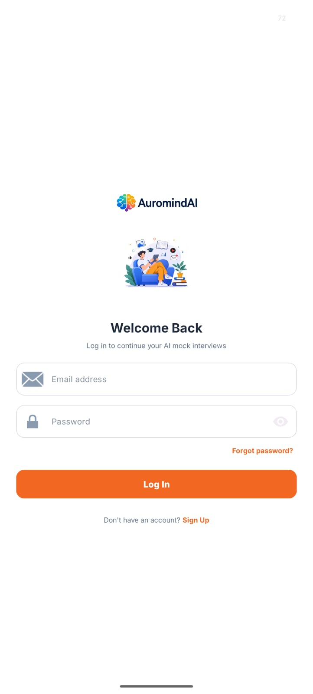
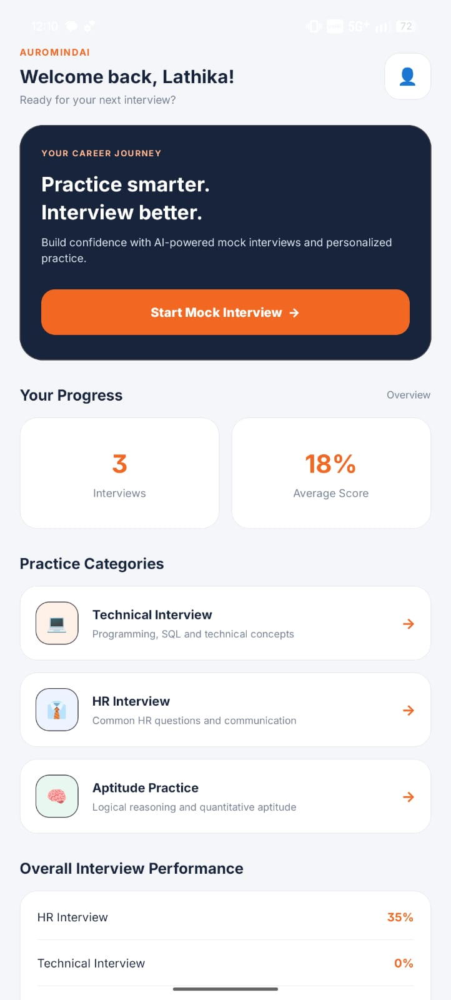
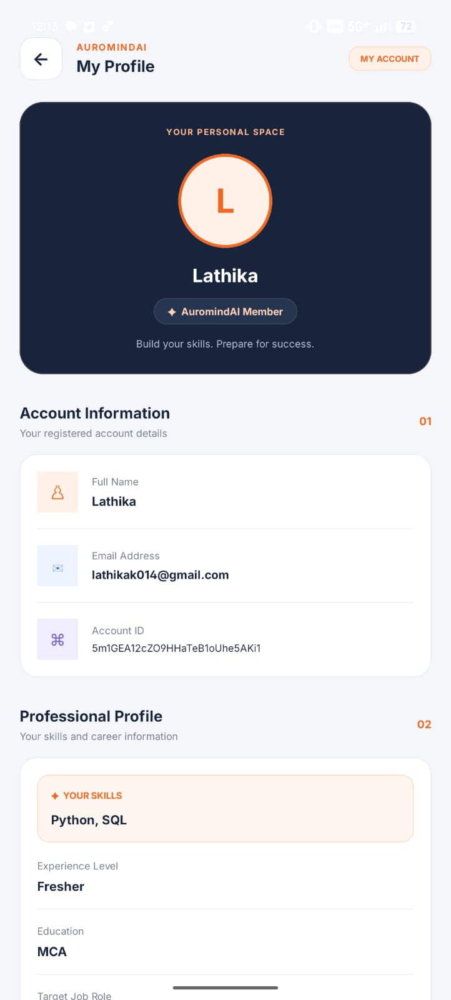

# LearningApp – AI-Powered Learning and Interview Preparation

LearningApp is an Android application developed using Kotlin and Android Studio. It helps students improve their aptitude skills and prepare for HR and technical interviews with AI-assisted features.

**GitHub Repository:** [Learning-app](https://github.com/Lathika-kathirvel/Learning-app)

## 🚀 Features

- User registration and login
- Firebase authentication
- Student dashboard
- Aptitude practice, questions, and results
- Technical interview preparation
- AI-assisted technical question generation
- HR interview preparation
- Resume-based interview preparation
- PDF resume text extraction
- AI interview performance analysis and feedback
- User profile management
- Recent activity tracking

## 🛠️ Technologies Used


| Technology | Purpose |
|---|---|
| Kotlin | Android application development |
| Android Studio | Development environment |
| XML | UI design |
| Firebase Authentication | User authentication |
| Firebase Firestore | Cloud database |
| Retrofit | API integration |
| OkHttp | Network communication |
| Gson | JSON parsing |
| Kotlin Coroutines | Background operations |
| RecyclerView | Displaying lists |
| PDFBox Android | PDF text extraction |
| Groq AI | AI-powered question generation (where configured) |

## 📱 Application Modules

### 1. User Authentication
- User registration
- Login functionality
- Firebase authentication


### 2. Dashboard
- Centralized learning dashboard
- Navigation to learning modules
- Recent activity

### 3. Aptitude Practice
- Configure aptitude practice sessions
- Answer aptitude questions
- Calculate scores
- Display results

### 4. Technical Interview
- Configure technical interview sessions
- Generate or display technical questions
- Practise technical MCQs
- View interview results

### 5. HR Interview
- HR interview preparation
- Practise common HR questions

### 6. Resume-Based Interview
- Upload a PDF resume
- Extract resume text
- Generate interview-related questions

### 7. AI Interview Analysis
- Review interview performance
- Display feedback and performance insights

### 8. Profile Management
- View user details
- Update profile information

## 📸 Application Screenshots

The following screenshots are available in the `Screenshot` folder of this repository.

### Login Screen


### Dashboard



### AI-Generated Questions


### AI Feedback


### Interview Details


### Profile


## 🎧 Output File

The repository includes an output file named `Output Video.mp3`.

[Open or download the LearningApp output audio (MP3)](Output%20Video.mp3)

> Note: The file has an `.mp3` extension, so it is an audio file, not a video. If you want to show an application demonstration video in this section, upload the actual video as an `.mp4` file and link it here, for example: `[Watch LearningApp Demo](assets/LearningApp-Demo.mp4)`.

## 📂 Project Structure


```text
LearningApp/
├── app/
│   ├── src/
│   │   └── main/
│   │       ├── java/com/example/learningapp/
│   │       │   ├── api/
│   │       │   ├── DashboardActivity.kt
│   │       │   ├── AptitudeSetupActivity.kt
│   │       │   ├── AptitudeQuestionsActivity.kt
│   │       │   ├── AptitudeResultActivity.kt
│   │       │   ├── TechnicalInterviewSetupActivity.kt
│   │       │   ├── GeneratedQuestionsActivity.kt
│   │       │   ├── HRInterviewActivity.kt
│   │       │   ├── AIResumeInterviewActivity.kt
│   │       │   ├── AIInterviewAnalysisActivity.kt
│   │       │   └── ProfileActivity.kt
│   │       ├── res/
│   │       └── AndroidManifest.xml
│   └── build.gradle.kts
├── gradle/

├── Screenshot/
│   ├── AI feedback.jpeg
│   ├── AI ques.jpeg
│   ├── Dashboard.jpeg
│   ├── Interview details.jpeg
│   ├── Login.jpeg
│   └── Profile.jpeg
├── Output Video.mp3
├── build.gradle.kts
├── settings.gradle.kts
├── gradle.properties
└── README.md
```

## ⚙️ Installation and Setup

### Step 1: Clone the Repository

```bash
git clone https://github.com/Lathika-kathirvel/Learning-app.git
```

### Step 2: Open in Android Studio

1. Open Android Studio.
2. Select **Open**.
3. Choose the cloned `Learning-app` folder.
4. Wait for Gradle synchronization to complete.

### Step 3: Firebase Configuration

1. Create a Firebase project.
2. Register your Android application in Firebase.
3. Add the required `google-services.json` file inside the `app/` directory.
4. Enable Firebase Authentication.
5. Configure Cloud Firestore if it is used by the application.

### Step 4: Configure AI Integration

Configure the required AI service credentials securely. Do not hard-code API keys in Kotlin source files or commit credentials to GitHub. If a key has been exposed, revoke it and create a replacement.

### Step 5: Run the Application

1. Connect an Android device or start an emulator.

2. Select the application run configuration.
3. Click **Run** in Android Studio.

## 🔐 Security

- Do not expose API keys in source code.
- Do not upload passwords or private credentials.
- Use secure configuration for API integrations.
- Keep signing credentials and other sensitive configuration files out of source control.

## 👩‍💻 Developed By

**Lathika Kathirvel**

GitHub: [Lathika-kathirvel](https://github.com/Lathika-kathirvel)

## 📄 License

This project is developed for educational purposes. No separate open-source license has been specified.
